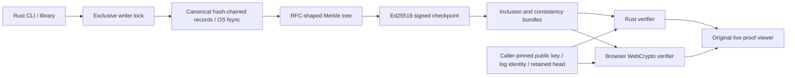

# Seal

When a log can be rewritten, signatures alone cannot show what disappeared; Seal checks chained records and Merkle proofs against a caller-pinned signing identity and retained checkpoint.

## Result

Observed tamper detection: 770/770 entry mutations and 5160/5160 single-bit file corruptions rejected (100% of this finite synthetic corpus), with a pinned signed head ([raw cases](docs/results/tamper.json), [results](docs/results/bench.json)).
Durable append: 367.3 entries/s median across 3 runs with per-entry OS fsync; checkpoint-batched mode 5,462.5 entries/s (different acknowledgement scope; [raw samples](docs/results/bench.json), [machine](docs/results/environment.json)).
At tree size 4097: inclusion path 416 bytes, full verification 45.75 µs median; consistency path 448 bytes, 77.62 µs median; real UI recording 93.80 s ([bundle sizes and timings](docs/results/bench.json), [browser proof](docs/results/browser/review.json)).

## Architecture



## Run it

Prerequisites: Rust/rustup, Python and Node. The repository pins the measured Rust release. No account, model, database or private data is needed. Open http://127.0.0.1:8093; the viewer clearly labels its public deterministic demo key. `make demo` seeds a local synthetic log and preserves it across restarts.

```sh
make demo
make lint test bench
./target/release/seal help
```

[CLI/key setup and recording](docs/DEMO.md) · [Actual video](docs/results/browser/demo.webm) · [Live UI screenshot](docs/results/browser/desktop.png)

## Decisions and limits

Complete for the stated local, single-writer log/proof scope. This is tamper **evidence**, not prevention, key custody or a production transparency service. A valid older signed prefix is indistinguishable from rollback unless a verifier retains a newer trusted head; [the benchmark demonstrates both cases](docs/results/bench.json). The demo key is public and provides no private signing identity. Obtain real trust anchors independently; a bundle cannot authorize its own key. The web application is not an external witness, timestamp authority or formal security audit.

The 100% figure covers the injected corpus, not every possible attack or an empirical guarantee of collision resistance. Entry deletion includes tail removal against the retained complete head. Canonical file encoding rejects representational byte edits as well as changed payloads. The file bit-flip sweep covers a separate small fixture; logical mutations cover a larger synthetic log. SHA-256/Ed25519 assumptions and uncompromised trust anchors remain prerequisites.

The Rust and browser verifiers check signatures, identity, record hashes and Merkle paths. Consistency proves a committed Merkle prefix, not every new hash-chain link or a timestamp. Browser JSON sizes must be safe JavaScript integers; the Rust format uses unsigned sizes. This uses RFC 9162's tree shape/proof algorithms with an original log/signature format, **not** its Certificate Transparency wire protocol.

An acknowledged default append has completed OS fsync; hardware power-loss behavior is not measured. Automatic checkpoints are periodic, while explicit checkpoint seals the current tail. The viewer forces a checkpoint after each demonstration append. Incomplete entries or checkpoint tails fail closed without silent truncation. A process crash can leave committed unsigned entries, a complete checkpoint, or an incomplete tail requiring operator recovery. There is no atomic cross-file transaction, replication or external effect guarantee.

Path sizes above count binary sibling hashes only. The measured compact JSON bundles are 1519 bytes for inclusion and 1758 bytes for consistency, including the entry/checkpoint/signatures. Verification timings include Ed25519, validation and Merkle hashing, exclude parsing/network/proof generation, and are local observations. Per-entry and batched-fsync rates must not be compared as equivalent per-record acknowledgement guarantees.

6 Rust tests and 5 real CLI/HTTP/file/process tests pass ([commands](docs/results/gates.txt)); a fresh independent clone passes setup/lint/tests/bench and actual `make demo`. Real SIGKILL/restart preserves an acknowledged signed append. [Quality report](docs/QUALITY.md) tracks native, browser, audit and actual Linux-container evidence.

Caught failures are retained: [compiler/header lifetime error](docs/results/development-lint.txt), [unsafe dependency rejected by the audit gate](docs/results/caught-audit-gate.txt), and [browser editor/load race](docs/results/caught-browser-load-race.txt). The dependency was upgraded; inputs lock during verification and stale verdicts clear. The current RustSec gate denies warnings without exclusions. Browser checks cover valid/corrupted native fixtures, both proof kinds, pinned-key preservation, download, responsive layouts and network recovery.

Docker and a Render free-plan template are prepared only; nothing is deployed. Free-plan container files are ephemeral and are not hosted durable custody. No old repository or kept project was changed. Tally integration is proposed separately and is gated on acceptance and explicit approval.

[Design/guarantees](docs/DESIGN.md) · [ADRs](docs/adr/) · [Interview](INTERVIEW.md) · [Drill](DRILL.md) · [Provenance](docs/migration/seal.md) · [CI](https://github.com/rjrddy/seal/actions)

## Next

Independent witnesses/gossip and checkpoint retention, reviewed key rotation and custody, chunked/indexed proof construction, backup/restore and operator recovery tooling, resource-bounded production HTTP infrastructure, and a formal cryptographic review. Keep any Tally bridge as a small separate change after approval.
